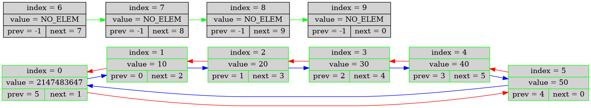

# Array-Based Doubly Linked List in C

A robust implementation of a doubly linked list in C using an array structure, equipped with comprehensive debugging features, Graphviz visualization, and HTML report generation.

### Structure Visualization

### Features

* **Array-Based Storage**: Efficient memory management using a single dynamically allocated array with free-list tracking.
* **Visual & HTML Dumps**: Generates interactive HTML dump reports containing text states and graphical representations of the list structure using Graphviz (`dot`).
* **Safety & Verification**: Includes structural verification (`list_verify`), canary values, and safe file operation wrappers.
* **Dynamic Resizing**: Automatically expands capacity when needed (`list_upgrade`).

### Requirements

* **Compiler**: A C++ compiler supporting modern standards (e.g., `g++` or `clang++`).
* **Graphviz**: The `dot` utility must be installed and available in the system PATH to generate visual diagrams (`.png`) from dumps.
* **Build Tools**: A POSIX-compatible shell environment to execute the build script (`build_list.sh`).
